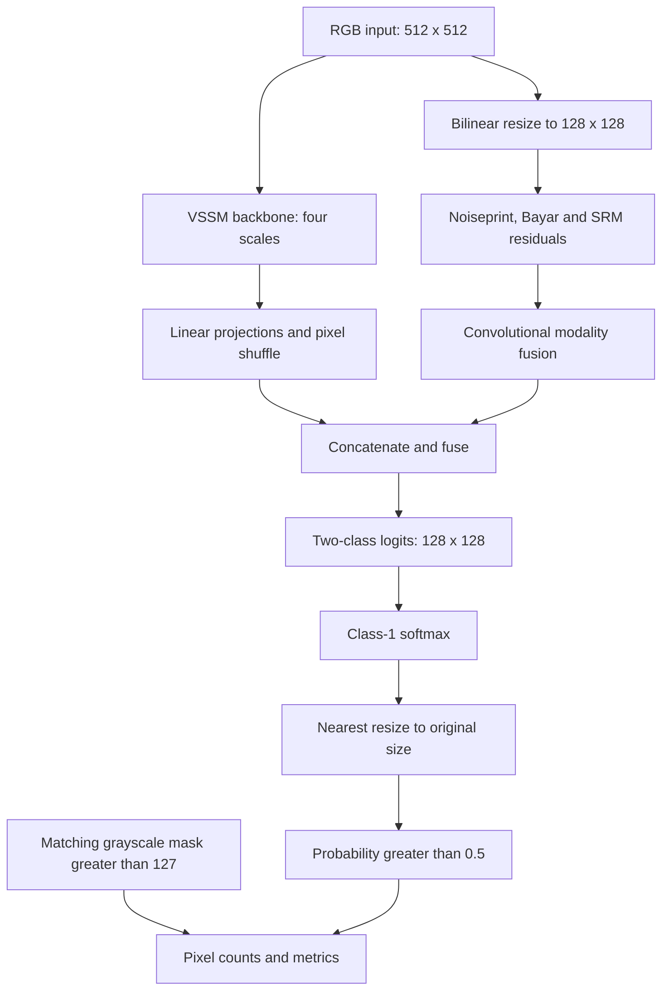

# ForMa on TGIF PS-sp: model and evaluation methodology

Documentation snapshot: **7 October 2026**. **8 October update:** SD2-sp support and run profiling are documented in Section 15; the original result tables remain the PS-sp snapshot. Tables are derived from [results/results_excel.xlsx](results/results_excel.xlsx), sheet `images`. This document describes the local implementation and measured experiment, not a reproduction of every experiment in the original paper.

## 1. Research question and scope

**How well does the released pretrained ForMa checkpoint localize manipulated pixels in the available TGIF Photoshop-spliced test subset, without local TGIF training or fine-tuning?**

The current experiment is pretrained-checkpoint transfer evaluation for **binary pixel localization**. The local evaluation performs no training, optimizer updates, or threshold search. Zero-shot is appropriate only in the operational sense of no local target-dataset adaptation. Whether every source was absent from the checkpoint's original training data has not been audited; a strict no-overlap or out-of-distribution claim remains unverified.

The workbook contains **2,058 manipulated images, 343 source IDs, and 13 categories**, restricted to `PS-sp/testing`. It contains no authentic-only examples, image-level classification gate, classification accuracy/F1, or ROC-AUC. Background pixels within manipulated images still contribute localization TN and FP.

The [official ForMa repository](https://github.com/multimediaFor/ForMa) provides the code and weights for Guo et al., *A Lightweight and Effective Image Tampering Localization Network with Vision Mamba*, IEEE Signal Processing Letters, 2025. The checkpoint came from the [authors' linked release](https://drive.google.com/file/d/15NcJQr5kxhqC4V-WjyJhAqIsobI6u-yh/view). The original training recipe and complete training-data provenance are not reconstructed by this evaluation.

### Evidence and implementation map

| Source | What it establishes |
| --- | --- |
| [models/vmamba_pixelshuf_modals.py](models/vmamba_pixelshuf_modals.py) | Actual backbone, residual modalities and decoder construction |
| [models/csms6s.py](models/csms6s.py), [models/csm_triton.py](models/csm_triton.py) | Selective-scan/cross-scan operations and backend fallbacks |
| [inference.py](inference.py) | Checkpoint load, preprocessing, inference and postprocessing |
| [metrics.py](metrics.py) | Pixel counts, metric formulas and undefined-value handling |
| [evaluate_tgif_category.py](evaluate_tgif_category.py) | Pairing, workbook identity, timing and aggregation |
| Excel `images` sheet | Historical settings, hashes, per-image counts, scores and timestamps |
| [show_results.py](show_results.py) | Read-only macro summaries |
| [visualize_results_figs.ipynb](visualize_results_figs.ipynb) | Charts and regenerated sample predictions |
| [evaluate_tgif_sample.py](evaluate_tgif_sample.py) | Earlier six-image source pilot and HTML/JSON artifacts |

Architecture details below are verified from the local code. External attribution is linked explicitly. Statistical procedures described later are proposed extensions, not completed significance tests. The category evaluator reads command-line arguments, **not** `config_pixelshuf_modals.yaml`; that YAML's training batch sizes do not describe this run.

## 2. How the implemented model works

The model receives only the RGB image. Ground-truth masks, category names and source IDs do not enter inference.



### 2.1 Visual state-space backbone

`Forensic_Vmamba` constructs `Backbone_VSSM()` with four stages of widths **96, 192, 384, 768** and depths **2, 2, 9, 2**. Patch embedding reduces spatial size by four; subsequent stage transitions reduce it by two. Normalized features are exported before each stage's downsampling, and the inherited classification head is removed.

| Feature for a 512 x 512 input | Channels | Spatial size |
| --- | ---: | --- |
| C1 | 96 | 128 x 128 |
| C2 | 192 | 64 x 64 |
| C3 | 384 | 32 x 32 |
| C4 | 768 | 16 x 16 |

Visual state-space blocks combine selective scanning, cross-direction scanning/merging, normalization, residual connections and an MLP branch. A simplified form of the recurrence implemented by the local PyTorch selective-scan fallback is

$$
h_t=\exp(\Delta_t A)\odot h_{t-1}+\Delta_t B_tu_t,
\qquad y_t=C_th_t+Du_t.
$$

Here $u_t$ is a scanned feature, $h_t$ a state, and $\Delta_t$, $B_t$, $C_t$ are input-dependent quantities. Batch/channel/group indices, feature projections and scan merging are omitted: this is not the entire network equation. The instantiated defaults include state dimension 1 and `forward_type='v2_noz'`. Backend availability affects speed and can affect numerical details.

### 2.2 Residual modalities

The RGB input is first resized to quarter resolution using bilinear interpolation with `align_corners=False`. Three forensic representations are extracted:

- **Noiseprint:** a 17-layer convolutional network produces one residual channel, repeated to three channels for fusion. Its parameters are frozen in the extractor. The full ForMa checkpoint supplies these weights.
- **Bayar:** a 5 x 5 constrained convolution fixes the filter center at -1 and normalizes surrounding coefficients to sum to 1. The constraint is applied during forward execution.
- **SRM:** three fixed high-pass filter outputs are clipped to [-2,2].

Each representation passes through an `EarlyConv` branch: three convolution/BatchNorm/ReLU layers followed by a 1 x 1 projection. The outputs are concatenated and mixed by another `EarlyConv` into three channels. Dropout is disabled in evaluation mode. These representations are intended to supply residual cues alongside RGB features; this benchmark contains no ablation proving each branch's individual contribution.

### 2.3 Decoder

The class called `SegFormerHead` uses a pixel-shuffle decoder in this implementation; this name does not make the entire network a SegFormer model. Linear projections and pixel-shuffle factors 2, 4 and 8 bring C2, C3 and C4 to C1's resolution, yielding four 96-channel maps. Fused residuals are projected from 3 to 16 channels. The resulting 400-channel concatenation is fused to 96 channels and projected to two logits:

$$
Z=f_\theta(X)\in\mathbb{R}^{1\times2\times128\times128}.
$$

Channel 0 is background and channel 1 is manipulation. This is a spatial output, not an image-level authenticity score. Resizing low-resolution output cannot restore boundary detail lost during input reduction.

### 2.4 Weights and execution

`load_model` constructs `Forensic_Vmamba(noiseprint_path=None)`, loads the checkpoint on CPU, extracts `model_state_dict` when present, strips a common `module.` prefix if applicable and loads with `strict=True`. Missing/incompatible parameters cause failure; no separate Noiseprint checkpoint is required. Only trusted checkpoints should be loaded because this path uses the full checkpoint loader with `weights_only=False`.

The model is moved to the chosen device, set to `.eval()`, and run under `torch.inference_mode()`. Output shape and finite logits are checked. Batch size is one. No test-time augmentation, tiling, ensemble, morphology, connected-component filtering or mask inversion is applied.

## 3. Dataset and mask-folder use

The [TGIF specification](https://github.com/IDLabMedia/tgif-dataset#filenaming) describes Photoshop/Firefly spliced images, bbox/segm masks, three generation variants, and Photoshop-adapted masks with an extra border. The local evaluator uses the following files:

```text
data_tgif/
  ps-sp_testing/testing/<category>/<source>_mask_<bbox|segm>.png_ps_<0|1|2>.png
  masks_testing/testing/<category>/<source>_mask_<bbox|segm>.png_ps_mask.png
```

The final `_ps_<variant>.png` in an image name is replaced by `_ps_mask.png`. All three variants share their source/type target. Bbox and segm are **different manipulated images with their own targets**, not two alternative annotations applied to the same prediction.

Example:

```text
image: ps-sp_testing/testing/hair-drier/350002_mask_bbox.png_ps_0.png
mask:  masks_testing/testing/hair drier/350002_mask_bbox.png_ps_mask.png
```

The evaluator first tries the exact mask-category folder; if absent, it tries replacing hyphens with spaces. This handles hair-drier, sports-ball, stop-sign and tennis-racket. Unexpected filenames and missing targets raise errors. Other mask representations, including plain `.png`, `_512.png`, and `_1024.png`, are not used.

There are 3,428 local mask PNGs, but only 686 distinct source/type adapted targets for these 2,058 images. Each source contributes three bbox and three segm images. In this snapshot each source occurs in one category, and no duplicate `(evaluation_id, category, source_id, mask_type, variant)` rows exist. Matching local inventory counts establish local coverage, not independent upstream archive completeness.

## 4. Preprocessing and ground-truth construction

For image $i$ of original size $H_i\times W_i$:

$$
X_i=\operatorname{CHW}\left(\operatorname{Resize}_{\mathrm{linear},512\times512}(\operatorname{RGB}(I_i))/255\right).
$$

OpenCV decodes BGR, converts to RGB, resizes with `INTER_LINEAR`, then creates float32 values in [0,1] and tensor shape `[1,3,512,512]`. There is no ImageNet normalization, padding, crop or augmentation. Nonsquare images are stretched to a square. This follows the RGB/resize/scaling sequence in the [upstream loader](https://github.com/multimediaFor/ForMa/blob/main/mydatasets.py).

Pillow loads the adapted ground truth as grayscale at original size. Its dimensions must match the image. It is not resized:

$$
G_i(p)=\mathbf1[M_i(p)>127].
$$

Thus values 128--255 denote manipulated pixels; 0--127 denote background. Intermediate gray border values are converted to hard labels, not fractional membership. This threshold is an explicit evaluation choice.

The workbook records

$$
a_i=\text{foreground fraction}_i=\frac{\sum_pG_i(p)}{H_iW_i},
\qquad b_i=\text{soft-border pixels}_i=\sum_p\mathbf1[0<M_i(p)<255].
$$

There are 1,917 image rows referencing a mask with intermediate values, not 1,917 unique masks. Widths range from 539 to 1,024 pixels and heights from 518 to 1,024.

**Entry-point distinction:** the category evaluator and notebook threshold adapted masks at 127. Standalone `inference.py --mask` instead requires already binary 0/1 or 0/255 masks and rejects soft values. These input contracts are not interchangeable.

## 5. From logits to predicted masks

At output-grid position $q$:

$$
P_i(q)=\frac{\exp Z_{i,1}(q)}{\exp Z_{i,0}(q)+\exp Z_{i,1}(q)}.
$$

The code applies PyTorch softmax, resizes the foreground probability map using Pillow nearest-neighbor interpolation, and thresholds:

$$
\widetilde P_i=\operatorname{Resize}_{\mathrm{nearest},H_i\times W_i}(P_i),
\qquad\widehat G_i(p)=\mathbf1[\widetilde P_i(p)>0.5].
$$

Ties are background. With nearest resizing and threshold 0.5 this agrees with two-class argmax followed by nearest resizing. No calibration or threshold optimization is performed by the evaluation script. The workbook records the threshold used, not its complete selection history.

### Difference from the authors' scoring path

The [upstream test script](https://github.com/multimediaFor/ForMa/blob/main/test.py) saves nearest-resized argmax masks; our scoring follows that binary-output convention. However, upstream [`calc_fixed_f1_iou`](https://github.com/multimediaFor/ForMa/blob/main/metric.py) resizes **logits bilinearly with `align_corners=True` before softmax/argmax** for metric calculation, and adds epsilon terms to ratios. Our scorer uses nearest-resized decisions and explicit undefined values. Boundary decisions and scores can differ. This is a declared local evaluation protocol, not exact reproduction of the paper's reported metric procedure.

## 6. Metric formulas

All counts are at original image resolution. The positive class is manipulation:

$$
\begin{aligned}
TP_i&=\sum_p\mathbf1[\widehat G_i(p)=1\land G_i(p)=1],\\
FP_i&=\sum_p\mathbf1[\widehat G_i(p)=1\land G_i(p)=0],\\
FN_i&=\sum_p\mathbf1[\widehat G_i(p)=0\land G_i(p)=1],\\
TN_i&=\sum_p\mathbf1[\widehat G_i(p)=0\land G_i(p)=0].
\end{aligned}
$$

The counts partition the image: $TP_i+FP_i+FN_i+TN_i=H_iW_i$.

| Metric | Formula | Interpretation |
| --- | --- | --- |
| Precision | $TP/(TP+FP)$ | Correct fraction of predicted manipulated pixels |
| Recall / sensitivity | $TP/(TP+FN)$ | Fraction of target manipulation recovered |
| F1 / Dice | $2TP/(2TP+FP+FN)$ | Foreground overlap balancing misses and false alarms |
| IoU / Jaccard | $TP/(TP+FP+FN)$ | Intersection divided by union |
| Specificity | $TN/(TN+FP)$ | Fraction of background correctly left unmarked |
| Pixel accuracy | $(TP+TN)/(TP+FP+FN+TN)$ | Correct fraction of all pixels |

Where defined, $F1=2PR/(P+R)$ and $F1=2IoU/(1+IoU)$ for a single image or pooled confusion table. **Macro F1 is not generally the harmonic mean of macro precision and macro recall.** Transforming mean IoU also does not generally yield mean F1.

The implementation uses the count formula directly, with no smoothing epsilon. Dice equals pixel F1; reporting both does not supply independent evidence.

### Undefined values

| Situation | Behavior |
| --- | --- |
| Zero denominator | `None`; blank/NaN in Excel |
| Empty prediction, nonempty target | F1=IoU=recall=0; precision undefined |
| Empty target, nonempty prediction | F1=IoU=precision=0; recall undefined |
| Both empty | F1 and IoU undefined; for a nonempty image, accuracy=specificity=1 |
| No background in target | Specificity undefined |

Undefined values are excluded from macro means per metric, with `defined_<metric>_count` recording the denominator. They are not silently replaced with 0 or 1. All reported metrics are defined for all rows in the current snapshot.

## 7. Macro, micro and category weighting

For metric $m_i$ and subset $S$, let $D_{S,m}$ contain only images where that metric is defined:

$$
\operatorname{Macro}_m(S)=\frac{1}{|D_{S,m}|}\sum_{i\in D_{S,m}}m_i.
$$

This is an average **across images**, not across foreground/background classes. A subset may be a category, mask type, category/type combination, or the full dataset. An empty defined set produces an undefined result.

Micro metrics first sum counts over images, e.g. $TP_S=\sum_{i\in S}TP_i$:

$$
\operatorname{MicroF1}(S)=\frac{2TP_S}{2TP_S+FP_S+FN_S},\qquad
\operatorname{MicroIoU}(S)=\frac{TP_S}{TP_S+FP_S+FN_S}.
$$

Other micro metrics use their corresponding count formulas. They are not generally image-count-weighted means of per-image scores; image sizes and foreground areas affect their contribution.

For fully defined metrics, the two overall macro summaries are

$$
M_{\mathrm{images}}=\frac1N\sum_i m_i,\qquad
M_{\mathrm{categories}}=\frac1C\sum_{c=1}^C\left(\frac1{N_c}\sum_{i\in c}m_i\right).
$$

With missing values, use metric-specific defined-image counts and omit categories with entirely undefined values for that metric. Equal category weighting gives the small hair-drier category the same influence as tennis-racket.

There is no explicit bbox/segm reweighting. In this balanced snapshot, equal numbers of defined scores give

$$
M_{c,\mathrm{combined}}=\tfrac12M_{c,\mathrm{bbox}}+\tfrac12M_{c,\mathrm{segm}}.
$$

Both types contribute 50% within each category and overall, because there are three variants of each per source. Missing images or undefined scores could change this. Identical scoring rules do not imply equal difficulty: targets, region sizes and manipulated image contents differ.

## 8. Recorded configuration and results

The following tables describe the workbook's single recorded configuration. They do not describe an earlier smoke-test environment or whichever notebook kernel is selected now.

| Setting | Recorded value |
| --- | --- |
| `evaluation_id` | `bce894a835eecfa44c2cea8272f14c3ba7bfb64ba11efcd5d1c4544c4d29b7b0` |
| `checkpoint_sha256` | `3c28719a48848411c4647e2460887d9a5d6eb64f2c3e3a77f5061c686925c2ee` |
| `protocol` | `forma-ps-sp-v1` |
| `device` | `cpu` |
| `threads` | `4` |
| `torch_version` | `2.14.0+cpu` |
| `input_size` | `512` |
| `prediction_threshold` | `0.5` |
| `ground_truth_threshold` | `127` |

Saved evaluation timestamps span **2026-10-01T05:33:10.840450+00:00 to 2026-10-06T21:59:25.814747+00:00** (UTC). The workbook does not record the historical Python, NumPy, OpenCV or Pillow versions, CPU model, or backend availability. Earlier environment listings cannot reliably fill these gaps.

### Per-category macro scores

| category | Images | Sources | F1 / Dice | Recall | Precision | IoU | Specificity | Pixel accuracy |
| --- | ---: | ---: | ---: | ---: | ---: | ---: | ---: | ---: |
| airplane | 168 | 28 | 0.4318 | 0.3910 | 0.6632 | 0.3228 | 0.9735 | 0.9412 |
| bear | 120 | 20 | 0.4648 | 0.3993 | 0.7038 | 0.3452 | 0.9797 | 0.9088 |
| elephant | 210 | 35 | 0.4354 | 0.3562 | 0.6768 | 0.3246 | 0.9895 | 0.9073 |
| hair-drier | 12 | 2 | 0.4103 | 0.3287 | 0.6280 | 0.2700 | 0.9851 | 0.9253 |
| kite | 186 | 31 | 0.3488 | 0.3156 | 0.6081 | 0.2413 | 0.9831 | 0.9464 |
| scissors | 54 | 9 | 0.1444 | 0.1518 | 0.2057 | 0.0939 | 0.9639 | 0.9193 |
| sheep | 168 | 28 | 0.3079 | 0.2788 | 0.5111 | 0.2165 | 0.9844 | 0.9269 |
| skis | 264 | 44 | 0.0985 | 0.1571 | 0.1146 | 0.0615 | 0.9691 | 0.9481 |
| snowboard | 120 | 20 | 0.2170 | 0.3505 | 0.2094 | 0.1444 | 0.9615 | 0.9471 |
| sports-ball | 132 | 22 | 0.2458 | 0.3819 | 0.2536 | 0.1819 | 0.9541 | 0.9420 |
| stop-sign | 120 | 20 | 0.6128 | 0.5648 | 0.8029 | 0.4773 | 0.9886 | 0.9520 |
| tennis-racket | 282 | 47 | 0.2207 | 0.3479 | 0.2331 | 0.1474 | 0.9608 | 0.9456 |
| zebra | 222 | 37 | 0.3557 | 0.3085 | 0.5777 | 0.2487 | 0.9750 | 0.8912 |

### Overall macro scores

| Group | F1 / Dice | Recall | Precision | IoU | Specificity | Pixel accuracy |
| --- | ---: | ---: | ---: | ---: | ---: | ---: |
| Equal image weight | 0.3150 | 0.3277 | 0.4542 | 0.2259 | 0.9739 | 0.9316 |
| Equal category weight | 0.3303 | 0.3332 | 0.4760 | 0.2366 | 0.9745 | 0.9309 |

### Scores by mask type

| mask_type | Images | Sources | F1 / Dice | Recall | Precision | IoU | Specificity | Pixel accuracy | Mean foreground fraction |
| --- | ---: | ---: | ---: | ---: | ---: | ---: | ---: | ---: | ---: |
| bbox | 1029 | 343 | 0.3078 | 0.2784 | 0.5085 | 0.2113 | 0.9750 | 0.9170 | 0.0830 |
| segm | 1029 | 343 | 0.3223 | 0.3770 | 0.3999 | 0.2406 | 0.9727 | 0.9462 | 0.0437 |

Bbox targets occupy approximately 8.30% of image area on average versus 4.37% for segm. Bbox has higher precision but lower recall; segm has slightly higher overall F1/IoU. These are descriptive associations, not proof of a causal mask-shape effect or statistical significance.

### Background-only baseline and interpretation

An all-background predictor would achieve

$$
\operatorname{MacroAccuracy}_{\mathrm{background-only}}=\frac1N\sum_i(1-a_i)=0.9366,
$$

compared with ForMa's 0.9316. This baseline is calculated from target fractions, not a separate inference run. On the current nonempty targets its F1=IoU=recall=0 and precision is undefined. ForMa's positive F1/IoU indicate foreground localization relative to that baseline; high accuracy alone conceals the imbalance. Pixel accuracy is not the fraction of images correctly detected.

Stop-sign has the highest category mean F1 and skis the lowest. Hair-drier has only two source IDs; its estimate is especially fragile. These are point estimates: no confidence intervals or p-values have been added to the workbook or the tables.

## 9. Workbook, provenance and resuming

| Sheet | Contents |
| --- | --- |
| `images` | Completed sample rows: category/source/type/variant, paths/hashes, settings, dimensions, timestamp, foreground/soft-border values, timings, counts and metrics |
| `category_summary` | Per configuration/category: `all`, `bbox`, `segm`; counts, macro/micro scores and defined-score denominators |
| `aggregated_results` | Combined mask types in one category/configuration row |

`evaluation_id` is SHA-256 of sorted JSON containing protocol, checkpoint SHA-256, input size, both thresholds, postprocessing description, device, threads and Torch version. `sample_key` hashes that ID plus absolute image/mask paths and file hashes.

Each completed image triggers a temporary-workbook write followed by destination replacement. Reruns skip existing sample keys. Interrupted runs retain completed rows; summaries include whatever is saved, including partial categories. `category_total_images` records the discovered category size. `--limit` takes the first N sorted filenames, not a random sample.

Paths are part of identity: relocating files or changing their contents can create additional historical rows for the same logical source/type/variant. No such duplicates occur in the current snapshot. The evaluation ID does not hash source code, most dependencies, hardware, or backend flags; it cannot alone certify reproducibility. Archive code and environment and use a separate workbook or versioned protocol for changed experiments. Use one writer at a time; close Excel during evaluation.

The category evaluator stores **scores, not prediction masks or probability arrays**. Visualizations regenerate selected predictions unless a compatible cache exists.

## 10. Running and reproducing the workflow

Run from the project root using the working ForMa environment:

```powershell
python ForMa/evaluate_tgif_category.py --category airplane --device cpu --threads 4 --input-size 512 --threshold 0.5
python ForMa/evaluate_tgif_category.py --category hair-drier --device cpu --threads 4
python ForMa/evaluate_tgif_category.py --category bear --limit 1 --output ForMa/results/category_smoke.xlsx
python ForMa/show_results.py
python -m unittest discover -s ForMa/tests -v
```

To evaluate all locally available categories sequentially:

```powershell
Get-ChildItem -Directory -LiteralPath 'ForMa/data_tgif/ps-sp_testing/testing' | ForEach-Object {
    python ForMa/evaluate_tgif_category.py --category $_.Name --device cpu --threads 4 --input-size 512 --threshold 0.5
    if ($LASTEXITCODE -ne 0) { throw "Evaluation failed for $($_.Name)" }
}
```

Use `--data-root`, `--weights`, and `--output` for alternative paths. `--device auto` chooses CUDA if available; the recorded evaluation used CPU. Input size must be a positive multiple of 32; changing it changes the protocol.

For future runs, archive the exact command, code commit/diff, checkpoint hash, dataset manifest, Python version, environment export (`python -m pip freeze` or `uv pip freeze`), OS, hardware and acceleration backends. The project `pyproject.toml` does not capture all inference/notebook dependencies and is not a complete environment lockfile. Historical Python 3.10/Torch 1.13 setup notes and synthetic smoke results are not the environment/results documented in the table above.

### Timing boundaries

For each invocation with pending samples, the evaluator loads the model once and performs one discarded warmup. It measures one forward per image, synchronizing CUDA when used.

- `forward_seconds` measures the model forward after input transfer; excludes loading, warmup, decoding, postprocessing, scoring and Excel writes.
- `processing_seconds` includes per-image preprocessing through score/row preparation, but excludes workbook writing, initial discovery/hashing, model loading and warmup.
- Summary timing is the mean of saved forward times.

This is not a repeated controlled latency benchmark. CPU fallback timing must not be presented as optimized GPU throughput. FLOPs, peak memory, parameter count and cross-model speed rankings require separate measurements and are not established by this workbook.

## 11. Graphs and qualitative examples

Open [visualize_results_figs.ipynb](visualize_results_figs.ipynb) in the Jupyter Notebook editor and select the ForMa environment. If needed, install plotting dependencies inside that kernel with `%pip install matplotlib pandas openpyxl ipykernel`.

The notebook shows overall/category macro scores, bbox/segm comparisons, a signed difference heatmap, distributions and foreground-area versus F1. It isolates one evaluation ID. Figures are saved under `results/figures/<evaluation-id-prefix>/`.

Use `SAMPLE_CATEGORY`, `SAMPLE_SOURCE_ID`, and `SAMPLE_VARIANT` to choose examples. By default it selects the upper-middle source in the sorted source-average F1 list **within the selected variant** and displays both mask types. This is illustrative selection, not random sampling or proof of representativeness.

The notebook validates checkpoint/image/mask hashes, reuses recorded thresholds/input size and regenerates predictions with the local inference functions. It checks all four confusion counts against the workbook. Cache files in `results/visualization_predictions/` are keyed by sample key, device, Torch version and a visualization-version string, but not every code/dependency change; invalidate the cache when those change.

Panels show manipulated RGB, binary ground truth, ForMa prediction and pixel errors (green TP, red FP, blue FN, black TN). The saved airplane source `567432`, variant 0, exactly reproduced both mask-type confusion tables: F1 approximately 0.1685 bbox and 0.8819 segm. This verifies two outputs, not every image across all environments.

The earlier `evaluate_tgif_sample.py --category sheep --source-id 154947` pilot exports HTML, JSON, CSV and per-image artifacts for six correlated examples; it is not the full benchmark. Standalone `inference.py` exports prediction/overlay PNGs, float probability NPY, probability PNG and metadata JSON. Its binary-mask requirement differs from the adapted-mask evaluator.

## 12. Reliability, error analysis and limitations

The current notebook and workbook are descriptive. For uncertainty, resample **source IDs**, retaining all related variants and mask types together. There are 343 source groups, assuming those groups are themselves independent; neither 2,058 images nor millions of pixels are independent experimental units.

For per-category intervals, resample sources within category. For overall intervals conditional on observed category composition, resample within each category and preserve the intended category weights. For micro scores, recompute pooled counts for each resample. With adequate sources, 10,000 source-cluster bootstrap resamples and a declared 95% interval method are a practical starting point. Hair-drier's two sources cannot support convincing generalization uncertainty; resampling cannot create new independent information.

For model comparisons, match identical evaluated samples and preserve source pairing. For bbox-versus-segm comparisons, average variants within each source/type and form paired source differences. Report effect sizes and intervals; a paired t-test requires defensible assumptions about source differences, and rank tests answer different hypotheses. Predefine comparisons and account for multiple testing. These analyses have not yet been executed as part of this documented snapshot.

Analyze failures by category, mask type, manipulated area, missed pixels, false-positive area and boundary behavior. The residual branches have not been ablated. Observed differences cannot isolate mask shape from content/generation effects. The current subset does not establish performance on other generators, fully regenerated images, authentic-only detection or broader datasets.

Keep every descendant of a source in the same train/validation/test split. Do not optimize thresholds on these test results and then claim an untouched evaluation. Original training-data overlap remains unaudited. Training-seed variability requires independently trained models; repeating fixed-checkpoint inference does not measure it.

## 13. Report-ready methodology paragraph

> We evaluated the released pretrained ForMa checkpoint without local TGIF fine-tuning on 2,058 PS-sp manipulated test images from 343 source images across 13 categories. Each source contributes three bounding-box-based and three segmentation-based variants. RGB images were linearly resized to 512 x 512 and scaled to [0,1]. Two-class output logits at quarter input resolution were converted to foreground softmax probabilities, nearest-resized to original image dimensions and thresholded strictly above 0.5. Matching Photoshop-adapted ground-truth masks were binarized strictly above grayscale value 127. Foreground precision, recall, F1/Dice and IoU were calculated from original-resolution pixel confusion counts, along with specificity and pixel accuracy. Macro results average defined per-image scores; equal-category averages are reported separately. The equal-image macro F1 and IoU were 0.3150 and 0.2259. This experiment measures localization on manipulated images, not image-level detection accuracy. It uses an explicitly declared local scoring protocol that differs from the upstream metric interpolation procedure; absence of overlap with the checkpoint's original training data has not been certified.

## 14. References and provenance gaps

- [Official ForMa code and citation](https://github.com/multimediaFor/ForMa).
- [Upstream data loader](https://github.com/multimediaFor/ForMa/blob/main/mydatasets.py), [test script](https://github.com/multimediaFor/ForMa/blob/main/test.py), [metrics](https://github.com/multimediaFor/ForMa/blob/main/metric.py).
- [TGIF specifications and file naming](https://github.com/IDLabMedia/tgif-dataset).

External code links target moving branches inspected on the documentation date. Pin revisions before publication. Historical dependency/hardware details not captured in the workbook, original training overlap, validated efficiency measurements, confidence intervals and significance tests remain outstanding; they are not supplied by this document.

```bibtex
@article{guo2025light,
  title={A Lightweight and Effective Image Tampering Localization Network with Vision Mamba},
  author={Guo, Kun and Cao, Gang and Lou, Zijie and Huang, Xianglin and Liu, Jiaoyun},
  journal={IEEE Signal Processing Letters},
  year={2025}
}

@InProceedings{mareen2024tgif,
  author={Mareen, Hannes and Karageorgiou, Dimitrios and Van Wallendael, Glenn and Lambert, Peter and Papadopoulos, Symeon},
  title={{TGIF}: Text-Guided Inpainting Forgery Dataset},
  booktitle={Proc. Int. Workshop on Information Forensics and Security (WIFS) 2024},
  year={2024}
}
```


## 15. SD2-sp evaluation and run profiling (8 October 2026)

The evaluator now supports `--subset ps-sp` (default) and `--subset sd2-sp`.
Sections 1--14 and their result tables remain the **7 October PS-sp snapshot**;
adding SD2 support does not turn those tables into SD2 measurements.

### SD2 file matching and separate results

SD2-sp images use the layout:

```text
data_tgif/sd2-sp_testing/testing/<category>/<source>_mask_<bbox|segm>.png_ps_mask.png_sd2_<0|1|2>.png
```

Their targets are the existing adapted masks:

```text
data_tgif/masks_testing/testing/<category>/<source>_mask_<bbox|segm>.png_ps_mask.png
```

All 2,058 local SD2-sp image/mask pairs across 13 categories were checked for
matching dimensions. SD2 folders use spaces for some categories; either
`--category hair-drier` or `--category "hair drier"` resolves them. Saved category
names use hyphens, consistently with the PS results. Both subsets use the same
preprocessing, prediction threshold, ground-truth threshold and metric formulas.

New rows have `generator=SD2`, `subset=SD2-sp` and protocol `forma-sd2-sp-v1`.
The ordinary PS protocol/configuration remains compatible with previous resume
identities. Different generator subsets have different evaluation IDs, and their
summaries remain separate even when stored in the same workbook. The notebook
lists evaluation IDs with subset labels and requires a selection when more than
one configuration is present. Its saved historical charts remain PS results
until rerun with the selected SD2 configuration.

From the project root:

```powershell
# Validate file matching and image/mask dimensions; no model or result rows
python ForMa/evaluate_tgif_category.py --subset sd2-sp --category all --check-only

# Evaluate every SD2 category, sequentially, with ordinary timing enabled
python ForMa/evaluate_tgif_category.py --subset sd2-sp --category all --device cpu --threads 4

# Or evaluate just one category
python ForMa/evaluate_tgif_category.py --subset sd2-sp --category airplane --device cpu --threads 4

# Display only SD2 scores in the shared workbook
python ForMa/show_results.py --subset sd2-sp
```

Default scores go to `ForMa/results/results_excel.xlsx`; existing PS rows are
retained. Use `--output ForMa/results/results_sd2.xlsx` for a separate workbook
and pass that path to `show_results.py --input` or the notebook's `WORKBOOK`.
Rerunning resumes completed samples. `--category all` loads/warms the model once
per category that has pending work and creates a report for each category.
`--limit N` applies per category, and `--check-only` validates the full selected
category even if a limit is supplied. Full CPU evaluation can be lengthy.

### Run reports: automatic, separate from quality scores

Each category invocation creates a unique folder under the output workbook's
parent directory in `runs/`; `--run-dir` overrides that location. New Excel rows
record `run_id` to connect them to the report. Historical rows do not acquire
retroactive timing data.

| Artifact | Contents |
| --- | --- |
| `run.json` | Status/error, configuration, selected/skipped/newly saved counts, wall and CPU time, stage summaries, throughput, available memory statistics, environment and code hashes |
| `images.csv` | One successfully saved new image per row: sample key, filename/type and stage timings including workbook writing |
| `profile.txt` | With `--profile`: top 80 Python functions by cumulative time |
| `profile.pstats` | With `--profile`: complete cProfile data for further inspection |

JSON is finalized on successful completion, ordinary exceptions or KeyboardInterrupt.
A forced process kill cannot guarantee final JSON; image CSV rows are flushed as
they are appended. A completed resume-only invocation has zero newly saved images
and null inference throughput rather than invented timing. Failure reports can
contain stage measurements for an attempted image that was not saved.

Stages include discovery, workbook reading, image/mask hashing and resume checks,
model loading, warmup, preprocessing/target loading, device transfer, forward,
postprocessing/metrics and workbook writing. Every stage summary includes count,
total, mean, median, p95, minimum and maximum seconds. These percentiles describe
the observed images, not a confidence interval or repeated same-image trial.
CUDA stages synchronize around forward/transfer measurements.

The per-category wall clock covers evaluation orchestration and workbook writes,
but excludes interpreter/import startup and final report export. Some setup
work is outside named stages, so their sum need not equal wall time.

$$
\text{forward-only images/s}=\frac{n_{\mathrm{forward}}}{\sum_j t_{\mathrm{forward},j}},
\qquad
\text{saved images/wall second}=\frac{n_{\mathrm{newly\ saved}}}{t_{\mathrm{invocation}}}.
$$

Wall throughput includes setup and Excel persistence, and depends on resume state
and workbook size. It is distinct from forward-only throughput. Process CPU time
includes CPU work across process threads and can exceed wall time.

`max_sampled_rss_bytes` is the largest process RSS observation at stage boundaries,
**not a continuously observed peak or model-only memory requirement**. It includes
Python, workbook, tensors and model. It is null if optional `psutil` is absent;
install `psutil` in the evaluation environment to enable it. CUDA runs also record
PyTorch peak allocated/reserved bytes for the measured loop after resetting the
peak counters following warmup. These exclude memory outside PyTorch's allocator.

The report records Python/package versions, OS/processor string, logical CPU count,
model parameter count, available backend flags, and hashes of the local evaluator,
inference, metrics, timing helper and model Python files. It does not compute
validated FLOPs, power/energy use, or continuous GPU utilization.

### Optional detailed code profiling

Use a small diagnostic run in a separate workbook:

```powershell
python ForMa/evaluate_tgif_category.py --subset sd2-sp --category airplane --limit 1 --device cpu --profile --output ForMa/results/sd2_profile.xlsx
```

`--profile` uses Python's [cProfile](https://docs.python.org/3/library/profile.html)
for Python call counts, self time and cumulative time. It profiles the category
invocation, including loading, warmup and persistence; it is not a PyTorch operator
or CUDA kernel trace. Profiling adds overhead. A `profiling=cProfile` configuration
field gives diagnostic runs a separate evaluation ID so their timings are not
silently mixed into ordinary runs. Use ordinary unprofiled runs for latency
comparisons. Repeating an already completed profile command resumes; use a new
output workbook to deliberately repeat inference rather than measuring a no-op.

For fair PS-versus-SD2 runtime comparisons, use the same device, environment,
input size, threads, warmup and comparable input groups. Prior PS forward times
remain available but lack the newly added stage and run metadata. Compare quality
on matched sources and report macro F1/IoU separately from runtime and memory.


```
python ForMa/evaluate_tgif_category.py --subset sd2-sp --category all --device cpu --threads 4
```

## 16. Localization summary by category and generator (12 October 2026)

Source: [results/results_excel.xlsx](results/results_excel.xlsx), `images` sheet. Values below are **macro averages of per-image localization scores**, on a 0?1 scale, rounded to four decimals. Bounding-box and segmentation examples are combined; each generator has 1,029 images of each mask type. Both generators cover the same 343 source IDs and 13 categories, with 2,058 evaluated images per generator.

Each category row gives every evaluated image equal weight. All seven metrics are defined for every image in this snapshot. F1 and Dice are identical by definition in this binary evaluator; they are both displayed to match the workbook. These are localization metrics, not image-level detection metrics.

### Per-category macro localization results

| Category | Generator | Images | Sources | Macro F1 | Macro recall | Macro precision | Macro IoU | Macro Dice | Macro specificity | Macro pixel accuracy |
| --- | --- | ---: | ---: | ---: | ---: | ---: | ---: | ---: | ---: | ---: |
| airplane | Photoshop / Firefly (PS-sp) | 168 | 28 | 0.4318 | 0.3910 | 0.6632 | 0.3228 | 0.4318 | 0.9735 | 0.9412 |
| airplane | Stable Diffusion 2 (SD2-sp) | 168 | 28 | 0.4856 | 0.4755 | 0.6301 | 0.3941 | 0.4856 | 0.9700 | 0.9449 |
| bear | Photoshop / Firefly (PS-sp) | 120 | 20 | 0.4648 | 0.3993 | 0.7038 | 0.3452 | 0.4648 | 0.9797 | 0.9088 |
| bear | Stable Diffusion 2 (SD2-sp) | 120 | 20 | 0.3449 | 0.3018 | 0.5154 | 0.2570 | 0.3449 | 0.9582 | 0.8801 |
| elephant | Photoshop / Firefly (PS-sp) | 210 | 35 | 0.4354 | 0.3562 | 0.6768 | 0.3246 | 0.4354 | 0.9895 | 0.9073 |
| elephant | Stable Diffusion 2 (SD2-sp) | 210 | 35 | 0.2745 | 0.2295 | 0.4793 | 0.1981 | 0.2745 | 0.9776 | 0.8814 |
| hair-drier | Photoshop / Firefly (PS-sp) | 12 | 2 | 0.4103 | 0.3287 | 0.6280 | 0.2700 | 0.4103 | 0.9851 | 0.9253 |
| hair-drier | Stable Diffusion 2 (SD2-sp) | 12 | 2 | 0.1552 | 0.1213 | 0.3354 | 0.0950 | 0.1552 | 0.9813 | 0.9056 |
| kite | Photoshop / Firefly (PS-sp) | 186 | 31 | 0.3488 | 0.3156 | 0.6081 | 0.2413 | 0.3488 | 0.9831 | 0.9464 |
| kite | Stable Diffusion 2 (SD2-sp) | 186 | 31 | 0.2872 | 0.2726 | 0.4682 | 0.2095 | 0.2872 | 0.9751 | 0.9390 |
| scissors | Photoshop / Firefly (PS-sp) | 54 | 9 | 0.1444 | 0.1518 | 0.2057 | 0.0939 | 0.1444 | 0.9639 | 0.9193 |
| scissors | Stable Diffusion 2 (SD2-sp) | 54 | 9 | 0.1501 | 0.1287 | 0.2476 | 0.1021 | 0.1501 | 0.9700 | 0.9231 |
| sheep | Photoshop / Firefly (PS-sp) | 168 | 28 | 0.3079 | 0.2788 | 0.5111 | 0.2165 | 0.3079 | 0.9844 | 0.9269 |
| sheep | Stable Diffusion 2 (SD2-sp) | 168 | 28 | 0.2119 | 0.1882 | 0.4029 | 0.1420 | 0.2119 | 0.9775 | 0.9144 |
| skis | Photoshop / Firefly (PS-sp) | 264 | 44 | 0.0985 | 0.1571 | 0.1146 | 0.0615 | 0.0985 | 0.9691 | 0.9481 |
| skis | Stable Diffusion 2 (SD2-sp) | 264 | 44 | 0.0828 | 0.1385 | 0.0963 | 0.0498 | 0.0828 | 0.9688 | 0.9460 |
| snowboard | Photoshop / Firefly (PS-sp) | 120 | 20 | 0.2170 | 0.3505 | 0.2094 | 0.1444 | 0.2170 | 0.9615 | 0.9471 |
| snowboard | Stable Diffusion 2 (SD2-sp) | 120 | 20 | 0.1898 | 0.3114 | 0.1765 | 0.1235 | 0.1898 | 0.9586 | 0.9438 |
| sports-ball | Photoshop / Firefly (PS-sp) | 132 | 22 | 0.2458 | 0.3819 | 0.2536 | 0.1819 | 0.2458 | 0.9541 | 0.9420 |
| sports-ball | Stable Diffusion 2 (SD2-sp) | 132 | 22 | 0.2549 | 0.3923 | 0.2425 | 0.2000 | 0.2549 | 0.9562 | 0.9446 |
| stop-sign | Photoshop / Firefly (PS-sp) | 120 | 20 | 0.6128 | 0.5648 | 0.8029 | 0.4773 | 0.6128 | 0.9886 | 0.9520 |
| stop-sign | Stable Diffusion 2 (SD2-sp) | 120 | 20 | 0.5193 | 0.4992 | 0.6945 | 0.4109 | 0.5193 | 0.9790 | 0.9354 |
| tennis-racket | Photoshop / Firefly (PS-sp) | 282 | 47 | 0.2207 | 0.3479 | 0.2331 | 0.1474 | 0.2207 | 0.9608 | 0.9456 |
| tennis-racket | Stable Diffusion 2 (SD2-sp) | 282 | 47 | 0.1769 | 0.3019 | 0.1730 | 0.1171 | 0.1769 | 0.9587 | 0.9429 |
| zebra | Photoshop / Firefly (PS-sp) | 222 | 37 | 0.3557 | 0.3085 | 0.5777 | 0.2487 | 0.3557 | 0.9750 | 0.8912 |
| zebra | Stable Diffusion 2 (SD2-sp) | 222 | 37 | 0.2527 | 0.2327 | 0.3898 | 0.1759 | 0.2527 | 0.9623 | 0.8754 |

### Overall macro localization results

The equal-image average gives more influence to categories with more images. The equal-category average gives each of the 13 categories the same weight. Neither is a pooled-pixel (micro) score. Image/source counts describe the evaluated dataset for both aggregations.

| Aggregation | Generator | Images | Sources | Macro F1 | Macro recall | Macro precision | Macro IoU | Macro Dice | Macro specificity | Macro pixel accuracy |
| --- | --- | ---: | ---: | ---: | ---: | ---: | ---: | ---: | ---: | ---: |
| All images (equal image weight) | Photoshop / Firefly (PS-sp) | 2058 | 343 | 0.3150 | 0.3277 | 0.4542 | 0.2259 | 0.3150 | 0.9739 | 0.9316 |
| All categories (equal category weight) | Photoshop / Firefly (PS-sp) | 2058 | 343 | 0.3303 | 0.3332 | 0.4760 | 0.2366 | 0.3303 | 0.9745 | 0.9309 |
| All images (equal image weight) | Stable Diffusion 2 (SD2-sp) | 2058 | 343 | 0.2557 | 0.2806 | 0.3585 | 0.1865 | 0.2557 | 0.9677 | 0.9226 |
| All categories (equal category weight) | Stable Diffusion 2 (SD2-sp) | 2058 | 343 | 0.2605 | 0.2764 | 0.3732 | 0.1904 | 0.2605 | 0.9687 | 0.9213 |

### Configuration and traceability

Both subsets use the same checkpoint, 512 ? 512 model input, prediction threshold strictly greater than 0.5, grayscale ground-truth threshold strictly greater than 127, and nearest-neighbor resizing of predicted probabilities to original image resolution. Their evaluation IDs are kept separate:

- **Photoshop / Firefly (PS-sp):** `bce894a835eecfa44c2cea8272f14c3ba7bfb64ba11efcd5d1c4544c4d29b7b0`.
- **Stable Diffusion 2 (SD2-sp):** `bd5b2f0d76759cb101333c655ca249a21a5db2ed7e1c76efe640a8831251c10a`.

Category means were checked against the workbook?s `category_summary` rows with `mask_type=all`. These tables are descriptive point estimates; they do not include confidence intervals or establish statistical significance for generator differences.


## 17. Image detection from saved localization decisions

`evaluate_detection.py` derives an image score from the existing pixel confusion
counts without rerunning ForMa. For every image, predicted manipulated area is
`(TP + FP) / (TP + FP + FN + TN)`. Although these counts were stored during mask
evaluation, their sum TP+FP depends only on the predicted binary mask. No ground-truth
mask is used as a detection feature. The score is a fraction of image area, not a
calibrated probability that the image is forged. It uses the saved pixel threshold
(0.5 in the current workbook); changing that threshold requires new inference.

Export scores for both generators and all categories:

```powershell
python ForMa/evaluate_detection.py
```

This exports `results/detection/scores_only/image_scores.csv` and `report.json`.
The current workbook covers 4,116 manipulated images from 343 sources across 13
categories. The script checks configuration consistency and duplicate samples;
it operates on saved rows, so partial workbooks yield partial detection exports.

To generate binary predictions, explicitly supply an image-level threshold:

```powershell
# Illustrative only: 0.01 means strictly more than 1% predicted manipulated pixels.
# This value has NOT been validated and must not be presented as an optimized detector.
python ForMa/evaluate_detection.py --image-threshold 0.01
```

Thresholded exports go under `results/detection/threshold_0.01/`. A prediction is
`inpainted` when `area_score > image_threshold`; ties predict `authentic`. The
`recall_summary.csv` reports detected/missed manipulated images and recall overall,
by generator, by category, and by generator/category. A predicted authentic label
on this dataset is a missed manipulation, not evidence of a true negative.

All current examples have label 1. Therefore this script intentionally does not
report two-class accuracy, precision, F1, specificity, false-positive rate or ROC-AUC.
An always-inpainted detector would attain recall 1 on these data. The localization
F1 values previously reported are not detection F1. Small manipulated regions can
be missed by an area threshold even when their localized pixels are correct.

A complete binary detection evaluation additionally needs authentic examples and
a separate validation set containing both classes, with source-grouped splits.
Choose the score rule and threshold on validation, freeze them, then evaluate on
held-out authentic and manipulated examples. Record class prevalence and avoid
duplicating authentic originals merely to balance their many manipulated variants.
No threshold calibration or authentic-image inference is implemented by this
workbook-only script. Probability-based rules such as top-k mean cannot be
recovered from pixel counts and require saved probabilities or new inference.


## 18. Full binary detection with authentic test originals

Run from the project root in the same environment as localization:

```powershell
.\.venv\Scripts\python.exe ForMa/evaluate_full_detection.py --image-threshold 0.01
```

The script evaluates one `data_tgif/original/testing/<category>/<source>_orig.png`
per source. All 343 plain originals match the manipulated image dimensions; the
512/1024 suffixed versions are not counted as extra authentic examples. The
4,116 manipulated area scores are recovered from saved pixel counts. The model
checkpoint, input size, pixel threshold, device, thread count and PyTorch version
are matched to the saved evaluation. Authentic scores are cached for resuming.

The fixed image decision is area_score > 0.01, reusing the previously chosen
illustrative threshold without optimizing on this test set. This is a derived
ForMa detector, not a separately trained classification head. Results for this
threshold are exploratory because it was not independently calibrated.

Outputs appear in `results/full_detection/complete/threshold_0.01/`:

- `image_predictions.csv`: all 4,459 unique test images and their binary predictions.
- `detection_summary.csv`: confusion counts, accuracy, precision, recall, F1,
  specificity, false-positive rate, balanced accuracy, ROC-AUC and average precision.
- `detection_results.xlsx`: per-image and summary sheets.
- `report.json`: score rule, configuration, coverage and provenance.

Summary rows include combined results, PS-sp versus authentic, SD2-sp versus
authentic, and every category in each comparison. The same 343 authentic scores
are reused for the two separate generator comparisons, but counted only once in
the combined result. Generator comparisons each contain 2,401 images; the combined
comparison contains 4,459. Precision, F1, accuracy and average precision depend on
this imbalanced class composition. Do not average generator confusion tables to
get combined counts, because that would duplicate authentic samples.

ROC-AUC uses the continuous area score and average ranks for tied scores; average
precision groups equal scores before accumulating precision/recall. Neither uses
a sweep to select the reported threshold. These are image-level binary metrics,
not averages of localization metrics. Source-level dependence remains, and no
confidence intervals are calculated here. With `--limit N`, only N authentic
sources and their matching manipulations are exported under `partial/`.
