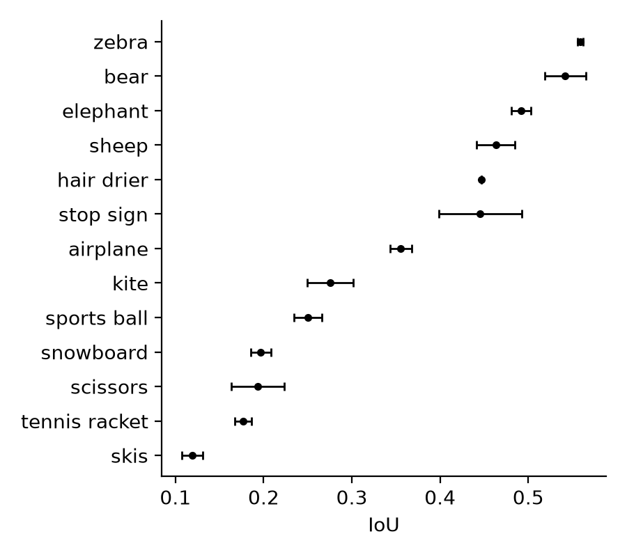
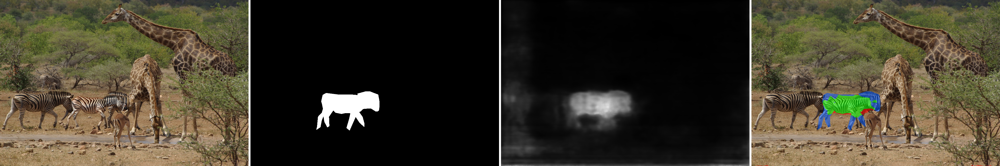
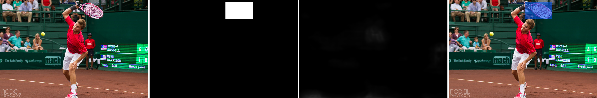
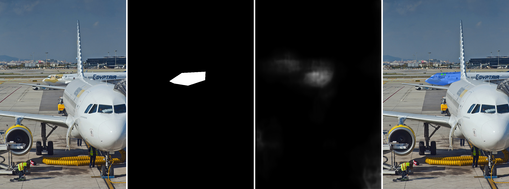

# PSCC-Net on TGIF (testing split): detection and localization

Zero-shot evaluation of the **official pretrained [PSCC-Net](https://github.com/proteus1991/PSCC-Net)**
(Liu et al., IEEE TCSVT 2022, [arXiv:2103.10596](https://arxiv.org/abs/2103.10596)) on the TGIF testing split
(SD2-sp and PS-sp). There is no TGIF fine-tuning: the official weights and network code are used unchanged. One
forward pass gives both the image score (detection) and the pixel mask (localization).

> PSCC-Net has **3.67 M parameters**, so we qualify it as a small model.

## Results (mean ± std over the 3 shared resamples)

Each resample has 275 source images and their 3,300 manipulated images (1,650 SD, 1,650 PS). Detection uses
`score > 0.5`; localization uses mask threshold **0.2**, ungated, on the manipulated images.

**Detection**

| Authentic set | Accuracy | Precision | Recall | F1 | ROC-AUC |
|---|---:|---:|---:|---:|---:|
| original only (275, team protocol) | 0.6566 ± 0.0104 | 0.9243 ± 0.0002 | 0.6840 ± 0.0124 | 0.7862 ± 0.0081 | 0.4976 ± 0.0006 |
| original + 512 + 1024 versions (825) | 0.6561 ± 0.0085 | 0.8572 ± 0.0009 | 0.6840 ± 0.0124 | 0.7609 ± 0.0078 | 0.6081 ± 0.0029 |

With the team protocol, detection is at chance (ROC-AUC 0.50) and below the "always manipulated" baseline
(Accuracy 0.9231, F1 0.9600). The higher AUC with the resized versions comes from the 512 versions, which PSCC-Net
mostly scores as authentic.

**Localization** (threshold 0.2)

| | IoU | Dice (= pixel F1) | Pixel Precision | Pixel Recall |
|---|---:|---:|---:|---:|
| macro, all | 0.3346 ± 0.0053 | 0.4106 ± 0.0065 | 0.4683 ± 0.0089 | 0.4814 ± 0.0087 |
| macro, PS | 0.4513 ± 0.0064 | 0.5446 ± 0.0081 | 0.5886 ± 0.0120 | 0.6211 ± 0.0085 |
| macro, SD | 0.2179 ± 0.0055 | 0.2766 ± 0.0063 | 0.3480 ± 0.0062 | 0.3416 ± 0.0094 |
| pooled, all | 0.3645 ± 0.0023 | 0.5343 ± 0.0024 | 0.4569 ± 0.0073 | 0.6436 ± 0.0127 |

**Threshold and gating** (macro, all manipulated images)

| | IoU | Dice | Pixel Precision | Pixel Recall |
|---|---:|---:|---:|---:|
| threshold 0.5 (official), ungated | 0.2096 ± 0.0032 | 0.2681 ± 0.0042 | 0.4531 ± 0.0058 | 0.2456 ± 0.0036 |
| **threshold 0.2, ungated** | 0.3346 ± 0.0053 | 0.4106 ± 0.0065 | 0.4683 ± 0.0089 | 0.4814 ± 0.0087 |
| threshold 0.2, gated | 0.2422 ± 0.0051 | 0.2953 ± 0.0058 | 0.3388 ± 0.0075 | 0.3456 ± 0.0026 |

- **Macro** averages per-image metrics; **pooled** sums TP/FP/FN over all pixels.
- **Gated** means the mask is set to empty when the detector calls the image authentic.
- **Threshold:** 0.2 is not the official setting and was not chosen on a separate validation split.
- **Std:** the resamples overlap by about 80%, so the std understates the uncertainty.

Per category, IoU ranges from 0.12 (skis) to 0.56 (zebra); see the figure below (hair drier has only 2 sources). All tables
(including per category and PS/SD splits) are in [`results/tables/`](results/tables/) and, for the team protocol,
[`results/tables_orig_only/`](results/tables_orig_only/). `pscc_per_image.csv` in each has one row per image
in the shared template.



## Examples

Input | ground truth | predicted map | overlay (green = correct, red = false alarm, blue = missed).

| | |
|---|---|
|  | **Good PS case** (zebra): IoU 0.55. |
|  | **Failed SD case** (tennis racket): detected (score 0.998), but IoU 0. |
|  | **Threshold 0.5:** IoU 0.01. |
|  | **Same image at threshold 0.2:** IoU 0.55. |

More examples are in [`figures/examples/`](figures/examples/).

## Layout

```
infer.py          inference -> detection.csv + localization.csv (resumable)
results.ipynb     all tables and the figure, from results/thr05, results/thr02 and resamples/
models/, utils/   official PSCC-Net code
resamples/        the 3 shared resamples
results/          thr05/, thr02/ (raw per-image results), tables/, tables_orig_only/
figures/          category figure and examples
```

## Reproduce

1. **Data:** [TGIF](https://github.com/IDLabMedia/tgif-dataset) testing files in
   `tgif/{orig,ps-sp,sd2-sp,masks}_testing/testing/<category>/`.
2. **Weights:** copy `checkpoint/` from the official repo (commit `53e5ff7`):
   ```
   git clone https://github.com/proteus1991/PSCC-Net.git ../PSCC-Net-upstream
   cp -r ../PSCC-Net-upstream/checkpoint ./checkpoint
   ```
   Expected SHA-256:
   ```
   d3b21edc4930187a6801cc818bd7b999fb5d8078d8f2e2193572e91ea5160096  checkpoint/HRNet_checkpoint/HRNet.pth
   11ea3461253cf059b299ad4b6b89008485f94a2d2b2da83ec28c2282a095b00b  checkpoint/NLCDetection_checkpoint/NLCDetection.pth
   a17581e8a3489a360257a266ca9b2db1b7c9b43337fbcc4aeb8d751f593f66f5  checkpoint/DetectionHead_checkpoint/DetectionHead.pth
   ```
3. **Environment** (Python 3.11):
   ```
   python -m venv .venv
   .venv\Scripts\activate          # Linux/macOS: source .venv/bin/activate
   pip install -r requirements.txt --extra-index-url https://download.pytorch.org/whl/cpu     # CPU
   pip install -r requirements.txt --extra-index-url https://download.pytorch.org/whl/cu126   # or CUDA GPU
   ```
   Keep the environment active for the steps below (the notebook command uses its kernel).
4. **Quick test** (2 manipulated + 2 authentic images, about 30 s on CPU):
   ```
   python infer.py --out quick_check/thr05 --loc-threshold 0.5 --files 509735_mask_segm.png_ps_1.png 409211_mask_bbox.png_ps_mask.png_sd2_0.png 409211_orig.png 127530_orig_512.png
   python infer.py --out quick_check/thr02 --loc-threshold 0.2 --files 509735_mask_segm.png_ps_1.png 409211_mask_bbox.png_ps_mask.png_sd2_0.png 409211_orig.png 127530_orig_512.png
   ```
   The zebra image (`509735_…ps_1`) should give IoU ≈ 0.55 at 0.5 and ≈ 0.49 at 0.2. Compare with the same rows in
   `results/thr05` and `results/thr02`: a CPU run gives scores within 0.001 of the stored results, which were run on
   a CUDA GPU.
5. **Full run** (5,145 images per threshold, about 5 s per image on an Intel Core Ultra 5 226V CPU with 16 GB RAM).
   `infer.py` skips images already in the output tables, so write to new folders:
   ```
   python infer.py --out results_new/thr05 --loc-threshold 0.5
   python infer.py --out results_new/thr02 --loc-threshold 0.2
   ```
6. **Tables:** set `RUNS` in the Settings cell of `results.ipynb` to the new folders (by default it reads the stored
   `results/thr05` and `results/thr02`), then:
   ```
   jupyter nbconvert --to notebook --execute --inplace results.ipynb
   ```

## Credit

`models/`, `utils/config.py` and the weights come from [PSCC-Net](https://github.com/proteus1991/PSCC-Net)
(commit `53e5ff77`, MIT licence, see [`LICENSE`](LICENSE)). The code is unchanged except for two compatibility
edits in `models/seg_hrnet.py`: `np.int` became `int`, and `torch.load` now has `map_location='cpu'`.
